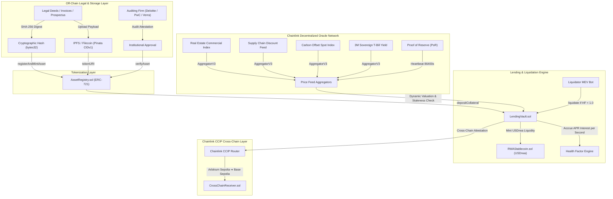

# AETHERIS // Trustless Cross-Chain Real-World Asset (RWA) Tokenization & Lending Protocol

> An institutional-grade, decentralized finance protocol enabling the tokenization, legal attestation, and over-collateralized borrowing against verified Real-World Assets (Commercial Real Estate, Accounts Receivable, Carbon Credits, Sovereign T-Bills) with automated Chainlink price oracles, Proof-of-Reserve validation, and CCIP cross-chain liquidity settlement.

---

## 🏛️ Architecture Overview



---

## 💎 Key Protocol Features

1. **AssetRegistry.sol (ERC-721)**:
   - Encapsulates off-chain legal prospectus via an on-chain `SHA-256` hash (`bytes32 documentHash`) and IPFS metadata hash (`tokenURI`).
   - Four distinct asset classes:
     - `REAL_ESTATE`: Commercial & residential fractions.
     - `INVOICE`: Corporate accounts receivable.
     - `CARBON_CREDIT`: Verra / Gold Standard certified offsets.
     - `TREASURY_BILL`: Sovereign short-term paper (3M T-Bills).
   - Multi-signature audit verification role (`VERIFIER_ROLE`) ensuring only fully attested assets can enter the lending vault.

2. **LendingVault.sol (Over-Collateralized Lending Engine)**:
   - Dynamic Loan-to-Value (LTV) limits per asset class:
     - Real Estate: **70% Max LTV**, **80% Liquidation Threshold**, 5.0% Borrow APR.
     - Invoices: **60% Max LTV**, **72% Liquidation Threshold**, 6.5% Borrow APR.
     - Carbon Credits: **50% Max LTV**, **65% Liquidation Threshold**, 8.0% Borrow APR.
     - Treasury Bills: **85% Max LTV**, **90% Liquidation Threshold**, 3.5% Borrow APR.
   - **Continuous Interest Accrual**: Computed per second on every user interaction:
     $$\Delta \text{Interest} = \frac{\text{Principal} \times \text{APR}_{\text{bps}} \times \Delta t}{10,000 \times 31,536,000}$$
   - **Real-Time Health Factor**:
     $$\text{Health Factor} = \frac{\text{Collateral Valuation}_{\text{USD}} \times \text{Liquidation Threshold}_{\text{bps}} \times 10^{18}}{10,000 \times \text{Total Debt}_{\text{USD}}}$$
     - Positions with $\text{Health Factor} < 1.0 \times 10^{18}$ become instantly liquidatable.
   - **Liquidation Bonus**: Liquidator repays bad debt in `USDrwa` and receives the underlying RWA NFT, pocketing the liquidation discount margin.

3. **Chainlink Oracles & Proof-of-Reserve**:
   - `AggregatorV3Interface` queries with staleness checks (`updatedAt > block.timestamp - HEARTBEAT`, `answeredInRound >= roundId`, `price > 0`).
   - Mock configurable aggregators for local test execution and stress-testing.

4. **Chainlink CCIP Cross-Chain Messaging**:
   - Supports Arbitrum Sepolia (`3478487238524512106`) and Base Sepolia (`10344971235874465080`) cross-chain credit lines.

---

## 🚀 Quick Start Guide

### 1. Launch Interactive Web DApp (Instant Access)
A standalone, self-contained interactive web portal is located on your desktop:
- Double-click **`C:\Users\SIDDHARDHA\Desktop\agent\run_rwa_protocol.bat`**
- Or open directly in any browser: **`C:\Users\SIDDHARDHA\Desktop\agent\rwa_lending_protocol.html`**

Features included in the Web DApp:
- 👑 **Issuer Portal**: Drag-and-drop document upload with real browser-native SHA-256 hash generation, IPFS CIDv1 formatting, and ERC-721 token minting.
- 💼 **Borrower Dashboard**: Real-time collateral management, animated Health Factor radial gauge, dynamic interest accrual counter, borrowing and loan repayments.
- ⚡ **Liquidator Panel**: Live protocol-wide loan registry, interactive **Oracle Price Shock Stress-Test Slider** (simulate market crashes from 0% to -60% to trigger liquidations), and 1-click liquidation execution with bonus profit calculations.
- 🔮 **Chainlink Feeds & Proof-of-Reserve**: Live heartbeat monitors, round IDs, and reserve backing verification.
- 🌉 **CCIP Bridge**: Animated cross-chain message flow between Arbitrum Sepolia and Base Sepolia.

---

### 2. Smart Contract Development & Testing

Navigate to the project folder:
```bash
cd "C:\Users\SIDDHARDHA\Desktop\agent\rwa-lending-protocol"
```

#### Compile Contracts:
```bash
npx hardhat compile
```

#### Run Automated Test Suite (100% Pass Rate):
```bash
npx hardhat test
```
Test suite covers:
- Asset registration and IPFS CID tokenization.
- Auditor verification gating collateral eligibility.
- Maximum LTV borrowing limits and edge case reverts on under-collateralized borrow attempts (`ExceedsBorrowCapacity`).
- Dynamic interest accrual over time.
- Prevention of collateral withdrawal while debt remains outstanding (`OutstandingDebt`).
- Oracle price shock simulation dropping Health Factor below 1.0.
- Liquidator bonus execution, NFT collateral transfer, and bad debt burn.
- Chainlink CCIP cross-chain message dispatch and authentication.

#### Run Local Seeding Script:
```bash
npx hardhat run scripts/seed-protocol.ts
```

#### Run IPFS Pipeline Script:
```bash
npx ts-node scripts/ipfs-upload-pipeline.ts
```

---

## 🌐 Testnet Deployment & Verification

### Arbitrum Sepolia
```bash
npx hardhat run scripts/deploy.ts --network arbitrumSepolia
```

### Base Sepolia
```bash
npx hardhat run scripts/deploy.ts --network baseSepolia
```

### Smart Contract Verification on Block Explorers
```bash
# Verify AssetRegistry
npx hardhat verify --network arbitrumSepolia <ASSET_REGISTRY_ADDRESS> <ADMIN_ADDRESS>

# Verify LendingVault
npx hardhat verify --network arbitrumSepolia <LENDING_VAULT_ADDRESS> <ADMIN_ADDRESS> <ASSET_REGISTRY_ADDRESS> <STABLECOIN_ADDRESS>
```

---

## 📁 Repository Structure

```
rwa-lending-protocol/
├── contracts/
│   ├── AssetRegistry.sol             # ERC-721 RWA token with IPFS & SHA-256 hash
│   ├── LendingVault.sol              # Over-collateralized vault & liquidation engine
│   ├── RWAStablecoin.sol             # Pegged USDrwa ERC-20 stablecoin
│   ├── MockChainlinkAggregator.sol   # Configurable Chainlink price feed
│   ├── CrossChainReceiver.sol        # CCIP cross-chain credit receiver
│   └── interfaces/
│       ├── IAssetRegistry.sol
│       ├── ILendingVault.sol
│       ├── IRWAStablecoin.sol
│       └── AggregatorV3Interface.sol
├── test/
│   └── LendingVault.test.ts          # Comprehensive Mocha/Chai test suite
├── scripts/
│   ├── deploy.ts                     # Multi-network deployment script
│   ├── seed-protocol.ts              # Local testnet data seeder
│   └── ipfs-upload-pipeline.ts       # IPFS packaging & SHA-256 digest utility
├── frontend/                         # Next.js 14 + TailwindCSS DApp
│   ├── src/
│   │   ├── app/                      # Next.js app directory
│   │   ├── components/               # Portals: Issuer, Borrower, Liquidator, CCIP
│   │   └── config/                   # Contract ABIs and network addresses
│   ├── package.json
│   └── tailwind.config.js
├── hardhat.config.ts                 # Hardhat configuration (Solidity 0.8.24 Cancun)
├── package.json
├── tsconfig.json
├── .env.example
└── README.md
```

---

## 🛡️ Security & Risk Considerations

1. **Reentrancy Protection**: All state-modifying external methods in `LendingVault.sol` utilize OpenZeppelin's `ReentrancyGuard` (`nonReentrant`).
2. **Oracle Staleness Guards**: Heartbeat staleness checks reject any oracle round older than `maxPriceStaleness` (default 24 hours).
3. **Pausable Circuit Breakers**: Emergency pause capability on both `AssetRegistry.sol` and `LendingVault.sol` for governance interventions.
4. **Custom Gas-Optimized Errors**: Reverts utilize custom Solidity errors (`ExceedsBorrowCapacity`, `HealthFactorHealthy`, `StalePriceFeed`, `OutstandingDebt`) for minimal gas overhead on Layer-2 rollups.

---
*Created for institutional decentralized finance with trustless automated oracles.*
